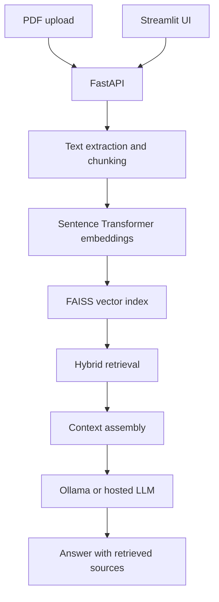

# AI Document Intelligence Platform

A Retrieval-Augmented Generation (RAG) application that lets users upload text-based PDFs, search their contents, and ask document-grounded questions.

Built with Python, FastAPI, Streamlit, Sentence Transformers, FAISS, and Ollama or an OpenAI-compatible hosted LLM.

## Features

- Upload and process text-based PDF documents (10 MB limit).
- Extract text, split it into overlapping chunks, and generate semantic embeddings.
- Store and search vectors with FAISS.
- Retrieve relevant passages using hybrid semantic and keyword ranking.
- Generate grounded answers using local Ollama or a hosted OpenAI-compatible LLM.
- Show retrieved source chunks alongside each answer.
- Search across all indexed documents or filter by a selected document.
- Prevent repeated indexing of identical PDFs using SHA-256 hashes.
- Return an insufficient-information response when the document context does not support an answer.

## Architecture



## Run locally

### Prerequisites

- Python 3.11+
- Git
- Ollama for local inference

### Install and configure

```bash
git clone https://github.com/MirMehdi05/ai-document-intelligence.git
cd ai-document-intelligence
python -m venv .venv
```

Windows PowerShell:

```powershell
.\.venv\Scripts\Activate.ps1
python -m pip install -r requirements.txt
Copy-Item .env.example .env
ollama pull llama3.2:latest
```

Start the backend:

```bash
python -m uvicorn main:app --reload
```

In a second terminal:

```bash
streamlit run streamlit_app.py
```

Open the Streamlit URL printed in the terminal (normally http://localhost:8501). The local default uses Ollama at http://127.0.0.1:11434.

### Use a hosted LLM locally

The app also accepts OpenAI-compatible chat-completions APIs. For example, to use Groq, set these values in `.env`:

```dotenv
LLM_PROVIDER=openai-compatible
LLM_API_KEY=your_provider_api_key
LLM_BASE_URL=https://api.groq.com/openai/v1
LLM_MODEL=openai/gpt-oss-20b
```

Never commit API keys or other secrets to GitHub.

## Deploy as a single Hugging Face Docker Space

The repository includes a Dockerfile, Nginx reverse proxy, and Supervisor configuration. These run the Streamlit UI and FastAPI backend in one container behind a single public port.

1. Create a new **Docker Space** on Hugging Face and choose CPU Basic hardware.
2. Push or sync the contents of this repository (including the root Dockerfile and this README) to the Space repository.
3. In the Space's **Settings → Variables and secrets**, add:
   - Secret `APP_PASSWORD`: choose a strong shared password for the demo.
   - Secret `LLM_API_KEY`: your hosted LLM provider API key.
   - Variable `APP_ENV`: `production`.
   - Variable `LLM_PROVIDER`: `openai-compatible`.
   - Variable `LLM_BASE_URL`: `https://api.groq.com/openai/v1` (or your compatible provider's URL).
   - Variable `LLM_MODEL`: `openai/gpt-oss-20b` (or a model enabled for your account).
4. Wait for the Space to build. Open its public URL and enter the shared demo password.

### Deployment notes

- The Docker container runs Nginx on port 7860, Streamlit on an internal port, and FastAPI on localhost only. The FastAPI routes are not exposed directly to the internet.
- In production, the Streamlit interface requires `APP_PASSWORD`; local development remains password-free unless you set it.
- This is a **shared-password portfolio demo**, not multi-user document isolation. Anyone with the password can see documents uploaded by other people who have the same password. Only upload documents you are permitted to share with those people.
- Hugging Face Space disk is ephemeral by default. Uploaded PDFs, FAISS vectors, and metadata can be lost when the Space stops, restarts, or rebuilds. Local development data remains persistent on your own machine. Add a separately configured persistent storage service before using this for long-term document storage.
- CPU Basic Spaces have 2 vCPU and 16 GB RAM, but creating Docker Spaces on CPU Basic requires Hugging Face PRO. Check current account pricing before subscribing.
- The hosted LLM key is stored as a Space secret, not in the repository. Provider usage limits and charges depend on your provider account.

## API endpoints (internal to the hosted container)

| Method | Endpoint | Purpose |
|---|---|---|
| POST | `/api/rag/upload` | Upload and index a PDF |
| GET | `/api/rag/documents` | List indexed documents |
| POST | `/api/rag/ask` | Ask a document-grounded question |
| GET | `/health` | Backend health check |

FastAPI runs internally on port 8000. Nginx intentionally blocks direct public access to these routes; the Streamlit server calls the API over localhost.

## Verification

The local MVP was manually tested for PDF extraction and indexing, document-grounded answers, insufficient-information responses, duplicate-upload prevention, and FAISS persistence across local application restarts. These checks are not a comprehensive production evaluation. Run the test suite with:

```bash
pytest -q
```

## Limitations

- Scanned or image-only PDFs require OCR, which is not implemented.
- Retrieval and generated answers can still be imperfect.
- The hosted demo does not provide per-user accounts or isolated document workspaces.
- Hosted demo storage is temporary unless an external persistent storage layer is configured.

## Privacy

Do not upload confidential, regulated, or personally sensitive documents to the shared demo. The application is intended for sample documents and portfolio evaluation.

## License

See the repository's license file, if provided.
