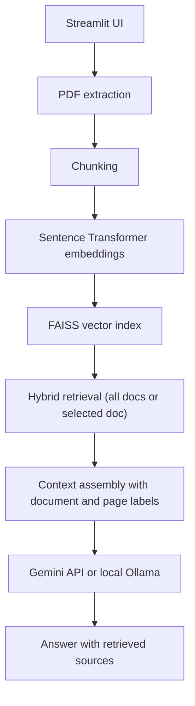

# AI Document Intelligence Platform

A Retrieval-Augmented Generation (RAG) application for uploading text-based PDFs, searching document contents, and asking document-grounded questions.

Built with Python, Streamlit, Sentence Transformers, FAISS, pypdf, and Ollama or Gemini API.

## Features

- Upload up to 5 text-based PDFs per batch (10 MB per file).
- Search across all indexed PDFs or limit retrieval to one selected document.
- Extract text and split it into overlapping chunks with page metadata.
- Generate semantic embeddings with Sentence Transformers.
- Store and search vectors using FAISS.
- Retrieve relevant passages using hybrid semantic and keyword ranking.
- Generate grounded answers using local Ollama or a hosted Gemini API.
- Display retrieved source passages with document names and PDF page-level references.
- Support conversational follow-up questions with short session-based chat history.
- Reset conversation context when new documents are added or the search scope changes.
- Retry temporary Gemini service errors and show clearer rate-limit or availability messages.
- Prevent duplicate indexing of identical PDFs using SHA-256 hashes.
- Keep each browser session's documents in a separate temporary index.

## Architecture

## Run locally

Requirements: Python 3.11+, Git, and Ollama for local inference.

1. Clone this repository.
2. Create and activate a Python virtual environment.
3. Install dependencies with python -m pip install -r requirements.txt.
4. Copy .env.example to .env.
5. Run ollama pull llama3.2:latest.
6. Start the app with streamlit run streamlit_app.py.

By default, local development uses Ollama at http://127.0.0.1:11434. The FastAPI API in main.py remains available for local API development, but the portfolio demo runs the RAG service directly inside Streamlit.

## Free public demo deployment

The simplest no-cost hosting option for this Streamlit project is Streamlit Community Cloud. It connects directly to GitHub and deploys the app from streamlit_app.py.

1. Push or merge the deployment branch to GitHub.
2. Open https://share.streamlit.io/ and sign in with GitHub.
3. Select Create app.
4. Choose this repository, the branch, and streamlit_app.py as the app file.
5. Select Python 3.11 in the app's advanced settings if prompted.
6. Deploy. The app receives a public streamlit.app URL.

### Optional: enable free-tier Gemini answer generation

The hosted app works without any secrets: semantic retrieval runs and the app displays the retrieved evidence. To also generate answers:

1. Create an API key in Google AI Studio: https://aistudio.google.com/apikey.
2. Use a model enabled for your account's free tier.
3. In Streamlit Community Cloud, open App settings → Secrets and add:

    LLM_API_KEY = "your-gemini-api-key"
    LLM_MODEL = "gemini-3.6-flash"

The app defaults to the Gemini-compatible provider in the cloud. Local development continues to use Ollama from your .env file.

Google's Gemini API currently offers a free tier for selected models, subject to rate limits and model availability. Free-tier content may be used to improve Google's products, so do not upload confidential, personal, or sensitive documents. Do not enable a paid tier for this portfolio app.

## Free-hosting limitations

- Streamlit Community Cloud is free, but its compute limits are shared and can vary. The Sentence Transformer and PyTorch dependencies may take time to install and load; if the app reaches its resource limit, reduce the model workload or use a local demo recording.
- Hosted demo storage is temporary. Documents and FAISS indexes can disappear after app restart or session termination.
- Each browser session gets a separate document index. This is a portfolio demo, not a production document-management service.
- Up to 5 PDFs can be selected in one batch; each file is limited to 10 MB. Larger workloads may exceed the free app's memory or compute limits.
- The first question after deployment may take longer while the embedding model downloads and loads.
- Scanned/image-only PDFs require OCR, which is not implemented.
- Retrieval and generated answers can still be imperfect.

## API endpoints for local backend development

| Method | Endpoint | Purpose |
|---|---|---|
| GET | /health | Backend health check |
| POST | /api/rag/upload | Upload and index a PDF |
| GET | /api/rag/documents | List indexed documents |
| POST | /api/rag/ask | Ask a document-grounded question |

## Verification

The local MVP was manually checked for PDF extraction and indexing, document-grounded answers, insufficient-information responses, duplicate-upload prevention, and FAISS persistence across local application restarts. Run tests with pytest -q.

For this multi-document update, verify by uploading two different sample PDFs, asking one question with **All documents** selected, then repeating with each individual document selected. Check that every citation shows the correct filename and page.

A successful GitHub push does not itself prove a successful Streamlit cloud deployment; verify by uploading sample PDFs and asking questions after deployment.

## Privacy

Use sample or public documents only in the hosted portfolio demo. Do not upload confidential, regulated, or personally sensitive material.
