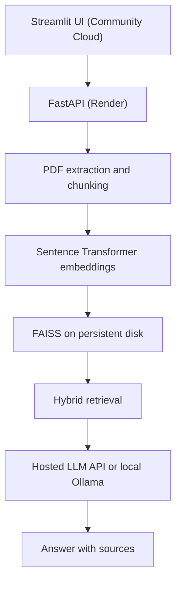

# AI Document Intelligence Platform

A Retrieval-Augmented Generation (RAG) application that lets users upload text-based PDFs, search their contents, and ask document-grounded questions.

Built with Python, FastAPI, Streamlit, Sentence Transformers, FAISS, and Ollama or an OpenAI-compatible hosted LLM.

## Features

- Upload and process text-based PDFs (10 MB limit).
- Extract text, split it into chunks, and generate semantic embeddings.
- Store and search vectors with FAISS.
- Retrieve relevant passages using hybrid semantic and keyword ranking.
- Generate grounded answers using local Ollama or a hosted LLM.
- Display retrieved source chunks for transparency.
- Search across all indexed documents or filter by a selected document.
- Prevent duplicate PDF indexing using SHA-256 hashes.

## Architecture



## Run locally

Requirements: Python 3.11+, Git, and Ollama for local inference.

```powershell
git clone https://github.com/MirMehdi05/ai-document-intelligence.git
cd ai-document-intelligence
python -m venv .venv
.\.venv\Scripts\Activate.ps1
python -m pip install -r requirements.txt
Copy-Item .env.example .env
ollama pull llama3.2:latest
```

Start the API:

```powershell
python -m uvicorn main:app --reload
```

In another terminal:

```powershell
streamlit run streamlit_app.py
```

Local mode uses Ollama at `http://127.0.0.1:11434` and does not require an app password or API token.

## Deploy using the same split-hosting pattern as OmniAgent

This project uses **Render for FastAPI** and **Streamlit Community Cloud for the Streamlit frontend**. Streamlit is not a Next.js app, so it cannot be deployed as a normal Vercel frontend. The split is otherwise similar: frontend and backend deploy independently from GitHub.

### 1. Deploy the FastAPI backend on Render

1. Open Render and create a new Blueprint using this repository and the deployment branch.
2. Render reads `render.yaml` and creates the `ai-document-intelligence-api` web service.
3. The service uses Python 3.11, runs `uvicorn main:app --host 0.0.0.0 --port $PORT`, and checks `/health`.
4. Add the secret `LLM_API_KEY` in the Render environment settings.
5. Wait for the service to finish building and copy its public URL, for example `https://ai-document-intelligence-api.onrender.com`.

The Blueprint uses a Starter instance and a 1 GB persistent disk mounted at `/data`. This is required because FAISS indexes and uploaded PDFs must survive service restarts. Render's free web services do not provide persistent disks; confirm the current plan price before creating the service.

### 2. Deploy the Streamlit frontend

1. Open Streamlit Community Cloud and choose **New app**.
2. Select this GitHub repository and the `deploy/huggingface-docker` branch.
3. Set the app file path to `frontend/streamlit_app.py` and the root directory to `frontend`.
4. In **Advanced settings → Secrets**, add:

```toml
APP_ENV = "production"
APP_PASSWORD = "choose-a-strong-demo-password"
RAG_API_URL = "https://YOUR-RENDER-SERVICE.onrender.com"
RAG_API_TOKEN = "COPY_THE_GENERATED_RENDER_TOKEN_HERE"
```

Copy the generated `RAG_API_TOKEN` value from Render's environment settings into Streamlit secrets. Use the exact same value on both services.

### 3. Configure the hosted LLM on Render

The Render Blueprint defaults to an OpenAI-compatible endpoint. Add your provider key as a Render secret:

- `LLM_API_KEY`: your provider API key.
- `LLM_PROVIDER`: `openai-compatible`.
- `LLM_BASE_URL`: `https://api.groq.com/openai/v1`.
- `LLM_MODEL`: `openai/gpt-oss-20b` or a model enabled for your account.

The key is used only by FastAPI and is not included in the Streamlit frontend.

### 4. Verify the deployment

- Open `https://YOUR-RENDER-SERVICE.onrender.com/health` and confirm it returns `{"status":"ok"}`.
- Open the Streamlit app and enter the demo password.
- Upload a small text-based PDF, index it, ask a question, and inspect the retrieved sources.
- Restart the Render service and verify that the indexed document remains available.

## Security and limitations

- The Streamlit app uses a shared demo password. This is a portfolio demo, not individual user authentication.
- The FastAPI RAG endpoints require a separate API token. The token is held in Streamlit server-side secrets and Render environment secrets; do not expose it in browser code.
- All visitors using the shared demo password access the same document collection. Do not upload confidential, regulated, or personal documents.
- A persistent disk preserves files across restarts but is not a backup. Back up important data separately.
- Scanned/image-only PDFs need OCR, which is not implemented.
- Retrieval and generated answers can still be imperfect.

## API endpoints

| Method | Endpoint | Purpose |
|---|---|---|
| GET | `/health` | Backend health check |
| POST | `/api/rag/upload` | Upload and index a PDF (API token required) |
| GET | `/api/rag/documents` | List indexed documents (API token required) |
| POST | `/api/rag/ask` | Ask a document-grounded question (API token required) |

## Verification

The local MVP was manually checked for PDF extraction and indexing, grounded answers, insufficient-information responses, duplicate-upload prevention, and FAISS persistence across local restarts. Run the tests with `pytest -q`. A cloud build and live deployment still need to be run after configuring the hosting accounts.
